  <!-- Waving Header Banner -->
  

<h4 align="left">
  <code>namespace Profile {</code>
</h4>

<!-- ==================== HERO / ABOUT ME SECTION ==================== -->
<table border="0" width="100%">
  <tr>
    <td width="62%" valign="top">
      <h1>Hello World! 👋</h1>
      

        
      

      

        Welcome to my GitHub profile! I'm an Information Technology student with a passion for software engineering, mobile development, and 3D computer graphics. I love exploring new technologies and turning creative ideas into functional code.
      

      <ul>
        <li>🎓 <b>Education:</b> Computer Science & IT @ <i>IS Pascal Comandini</i></li>
        <li>💻 <b>Core Interests:</b> Software Architecture, Mobile Apps, Game Mechanics</li>
        <li>🎨 <b>Creative Hobby:</b> 3D Modeling & Rendering with <b>Blender</b></li>
        <li>🌱 <b>Currently Exploring:</b> Modern cross-platform apps & performance tuning</li>
      </ul>
    </td>
    <td width="38%" align="center" valign="middle">
      
    </td>
  </tr>
</table>

 

<!-- ==================== TECH STACK ==================== -->

  <h3>/* 🛠️ Tech Arsenal & Tools */</h3>
  
  

    
  

  

    
  

 

<!-- ==================== SOCIALS & CONNECT ==================== -->

  <h3>/* 🌐 Connect With Me */</h3>
  
  

    
    &nbsp;
    
    &nbsp;
    
    &nbsp;
    
  

  <!-- Visitor Counter -->
  

    
  

 

<!-- ==================== PACMAN ARCADE CONTRIBUTION GRAPH ==================== -->

  <h3>/* 🎮 Pacman Contribution Quest */</h3>
  
  <picture>
    <source media="(prefers-color-scheme: dark)" srcset="https://raw.githubusercontent.com/T0mmyChiucchi/T0mmyChiucchi/pacman-output/pacman-contribution-graph-dark.svg?game=pacman&v=1">
    <source media="(prefers-color-scheme: light)" srcset="https://raw.githubusercontent.com/T0mmyChiucchi/T0mmyChiucchi/pacman-output/pacman-contribution-graph.svg?game=pacman&v=1">
    
  </picture>

 

<!-- ==================== GITHUB ANALYTICS & STATS ==================== -->

  <h3>/* 📊 Analytics & Activity Dashboard */</h3>

  <!-- Panoramic Activity Graph -->
  

    
  

  
   

  <!-- Side-by-side Stats & Streak Cards -->
  

    
    &nbsp;&nbsp;
    
  

   

  <!-- Most Used Languages Card -->
  

    
  

 

<!-- ==================== MEME / FUN CORNER ==================== -->

  
   
  <i>POV: You just pushed directly to <code>main</code> on a Friday afternoon...</i>

 

<!-- ==================== WAVING FOOTER CLOSING NAMESPACE ==================== -->

  

